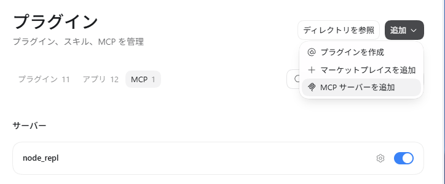
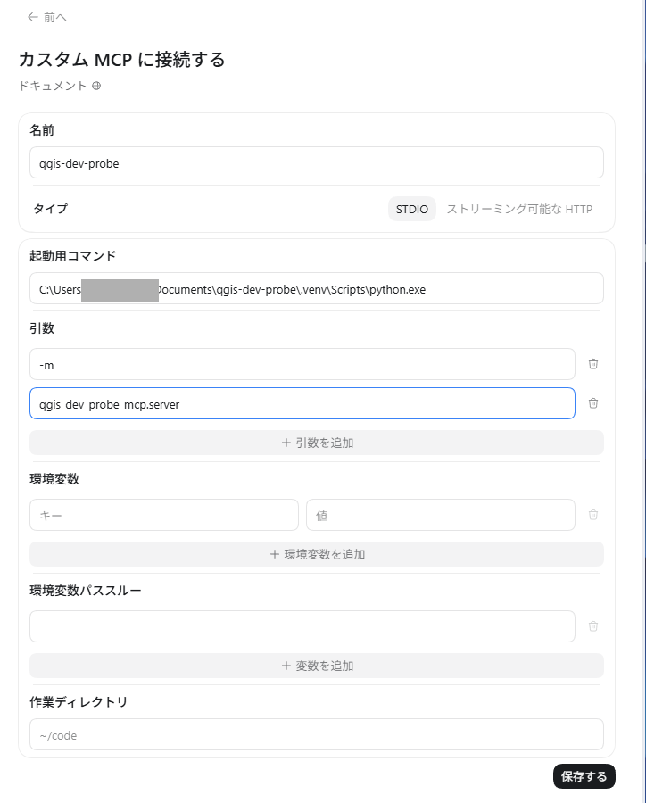
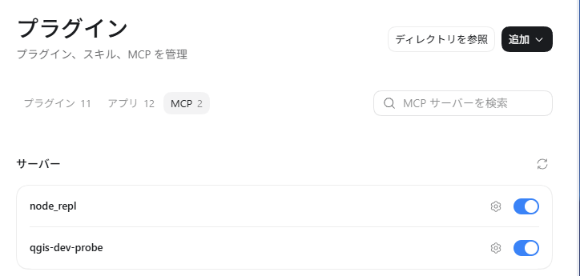
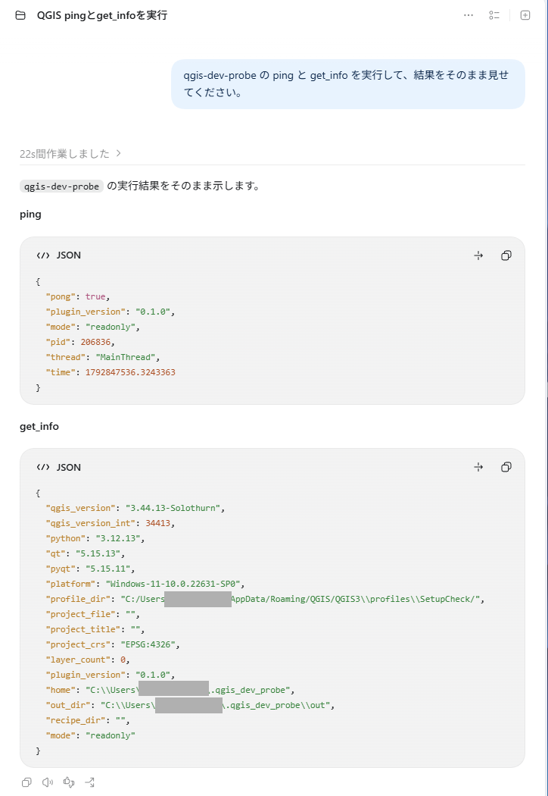

# クライアント設定

共通: MCP サーバーは `python -m qgis_dev_probe_mcp.server`（`pip install -e .` 後は `qgis-dev-probe-mcp` でも可）。
接続先は `endpoint.json` から自動取得するため、**クライアント設定にトークンは不要**。QGIS を同じ OS ユーザーで動かすこと（別ホームなら `QGIS_DEV_PROBE_HOME` を両方に設定）。

> Claude Desktop・Claude Code・Codex（ChatGPT デスクトップアプリ内の Codex）は実機で接続を確認済み。確認した範囲は各節に書いています。Codex の CLI と IDE 拡張は**未確認**です。

## どの AI・どの形態で使えるか（先に読んでください）

大原則は 1 つです。**AI クライアントが、QGIS と同じ PC の上で、ローカルのコマンド（stdio の MCP サーバー）を起動できること。** このツールの接続先はその PC の localhost だけなので、ブラウザやクラウド側で動く形態からは、どの AI でも届きません。

### Claude の場合

| 形態 | 可否 | 設定の場所 |
|---|---|---|
| Claude Desktop（デスクトップアプリ） | **使える**（実機確認済み） | アプリの「設定 → 開発者 → 構成を編集」で開く `claude_desktop_config.json`（下記） |
| Claude Code（デスクトップアプリ版・CLI 版） | **使える**（実機確認済み） | コマンド `claude mcp add` で登録（下記）。設定はユーザー側の設定ファイルに保存される |
| Claude ブラウザ版（claude.ai） | **使えない** | カスタムコネクタはリモート（HTTPS）の MCP サーバー専用で、自分の PC の localhost には接続できない |
| Claude スマホアプリ | **使えない** | 同上。スマホは「PC を遠隔操作する入口」にはなっても、接続の実体は PC 側のクライアントになる |

- デスクトップアプリでもブラウザ版でも、**チャット（AI との会話）そのものに MCP の設定はありません**。「AI で動くか、Code でないとダメか」という疑問への答えは、こうなります。必要なのは会話の種類ではなく、**MCP サーバーをローカルで起動できるクライアント**で、それが Desktop アプリと Code です。
- Claude Desktop の設定ファイルの場所: Windows は `%APPDATA%\Claude\claude_desktop_config.json`、macOS は `~/Library/Application Support/Claude/claude_desktop_config.json`。画面からは「設定 → 開発者 → 構成を編集」で開けます。編集したら、アプリを**完全に終了して**起動し直してください（ウィンドウを閉じるだけでは常駐が残ることがあります）。
- Claude Code の登録はフォルダ単位（local）が既定です。どのフォルダでも使うなら `-s user` を付けます。

### GPT の場合

| 形態 | 可否 | 設定の場所 |
|---|---|---|
| ChatGPT デスクトップアプリ内の **Codex** | **使える**（実機確認済み） | アプリの「設定 → 連携 → プラグイン → MCP タブ → 追加」（手順は下記 A）、または設定ファイル `config.toml`（下記 B） |
| Codex CLI・IDE 拡張 | 設定ファイルは共有（下記）。このツールへの登録自体は未確認 | `C:\Users\<ユーザー名>\.codex\config.toml`（macOS / Linux は `~/.codex/config.toml`） |
| ChatGPT の通常チャット（Chat） | **使えない** | コネクタはリモートの MCP サーバー専用で、ローカルのコマンドは起動できない |
| ChatGPT の Work（作業モード） | **使えない** | 実行環境がクラウド側にあるため、この PC の QGIS には届かない |

- GPT 側で使うのは **Chat でも Work でもなく Codex** です。Codex は「チャットのおまけ」ではなく、PC の上にデスクトップ環境として常駐して動くエージェントです。そのため前提も PC 側にあります（アプリの設定でエージェントの環境が「Windows ネイティブ」になっていること、作業中は PC が起動してサインインした状態であること）。
- Codex の設定は、デスクトップアプリ・CLI・IDE 拡張で **同じ `config.toml` を共有**します。画面から登録してもファイルに書いても、効果は同じです。

### 共通の前提条件

どのクライアントでも、次の 4 つがそろっている必要があります。

1. QGIS と AI クライアントが、**同じ PC・同じ OS ユーザー**で動いている（接続情報のファイル `endpoint.json` を共有するため）
2. [SETUP.md](SETUP.md) の手順 2 が終わっている（MCP サーバー入りの Python 仮想環境。クライアント設定には、その `python.exe` の**絶対パス**を書く）
3. QGIS が起動していて、Dev Probe のサーバーが「実行中 / RUNNING」になっている
4. クライアントの設定を変えたら、クライアントを**完全に再起動**する（MCP サーバーはクライアントの起動時に読み込まれる）

## Claude Desktop（`claude_desktop_config.json`）

```json
{
  "mcpServers": {
    "qgis-dev-probe": {
      "command": "C:\\path\\to\\repo\\.venv\\Scripts\\python.exe",
      "args": ["-m", "qgis_dev_probe_mcp.server"]
    }
  }
}
```

## Claude Code

```powershell
claude mcp add qgis-dev-probe -- C:\path\to\repo\.venv\Scripts\python.exe -m qgis_dev_probe_mcp.server
```
（`claude mcp add` は、実行したフォルダ限定（local）で登録される。どのフォルダでも使うなら `-s user`。構文は `claude mcp add --help` で要確認）

確認済み: Claude Code v2.1.310 で `claude mcp list` が Connected、ツール呼び出しも成功。呼び出しが `Login expired` になる場合は Claude Code 側で `/login`（このツールとは無関係）。

## Codex（OpenAI）

Codex は、ChatGPT デスクトップアプリ・Codex CLI・IDE 拡張の 3 つで **同じ設定ファイル（`C:\Users\<ユーザー名>\.codex\config.toml`）を共有**します（公式ドキュメントの記載。画面から登録した内容がこのファイルに書かれると推測していますが、ファイルの中身は未確認です）。どの入口から登録しても構いません。

### A. ChatGPT デスクトップアプリから登録する（実機で確認済み）

確認した環境: Windows 11、ChatGPT デスクトップアプリ（設定の「エージェントの環境」が「Windows ネイティブ」）、QGIS 3.44.13、qgis-dev-probe 0.1.0。画面の名称は 2026-10-24 時点のもので、アプリの更新で変わることがあります。

**事前に必要なもの**

- [SETUP.md](SETUP.md) の手順 2 が終わっていること（`.venv` ができていて、`python.exe` の**絶対パス**が分かる）。
- 絶対パスの確認コマンド（PowerShell 7）:

```powershell
Set-Location $HOME
(Resolve-Path "$HOME\Documents\qgis-dev-probe\.venv\Scripts\python.exe").Path
```

**手順**

1. アプリの「設定」を開き、左のメニュー「連携」の「プラグイン」を選びます。公式ドキュメントにある「MCP servers」という項目は、この画面では見つかりませんでした。「接続」（コーディングの下にある項目）は、スマートフォンなど別の機器からこの PC を操作するための設定で、**MCP とは無関係**です。
2. 上のタブ「MCP」を開き、右上の「追加」を押して、一番下の「MCP サーバーを追加」を選びます。



3. 「カスタム MCP に接続する」の画面に、次のとおり入力して「保存する」を押します。

| 項目 | 入力する値 |
|---|---|
| 名前 | `qgis-dev-probe` |
| タイプ | `STDIO`（そのまま） |
| 起動用コマンド | 手順「事前に必要なもの」で確認した `python.exe` の絶対パス |
| 引数 1 つ目 | `-m` |
| 引数 2 つ目 | `qgis_dev_probe_mcp.server` |
| 環境変数・環境変数パススルー・作業ディレクトリ | 空のまま |

- 引数は、「+ 引数を追加」で欄を増やし、**1 つの欄に 1 つずつ**入れます。`-m qgis_dev_probe_mcp.server` を 1 つの欄にまとめないでください。引数の欄を空のまま保存すると、`python.exe` だけが起動してしまい、接続できません。
- トークンは入れません。接続先は `endpoint.json` から自動で取得されます。



4. 保存すると、「MCP」タブの「サーバー」に `qgis-dev-probe` が加わり、右のスイッチが青（有効）になります。ここまでで**登録は完了**ですが、QGIS とつながるかどうかは、次の疎通確認で確かめます。



**疎通確認**

前提: QGIS が起動していて、QGIS Dev Probe のダイアログの状態が「実行中 / RUNNING」であること（[SETUP.md](SETUP.md) の手順 3）。

Codex の入力欄に次の文を送ります。実行の許可を求められたら許可します（この 2 つは QGIS の状態を読むだけで、何も変更しません）。

```
qgis-dev-probe の ping と get_info を実行して、結果をそのまま見せてください。
```

成功すると、`ping` は `"pong": true` を返し、`get_info` の `profile_dir` に、接続中の QGIS のプロファイル名が出ます。



**確認できた範囲と、できていない範囲**

| 項目 | 状態 |
|---|---|
| 登録（上記の画面操作）と `ping` / `get_info` の呼び出し | 確認済み（2026-10-24）。同じ QGIS（同じ `pid`）に、Claude と Codex が同時に接続できた |
| 初回の実行時間 | 約 22 秒かかった。MCP サーバーの起動待ちか Codex 側の処理かは**不明** |
| `screenshot` の画像が Codex の画面に表示されるか | **未確認** |
| `interactive` モードの操作・`run_algorithm`（長時間処理）のタイムアウト | **未確認** |
| Codex CLI（`codex mcp add`）・IDE 拡張からの接続 | **未確認** |
| 設定ファイル `config.toml` に実際に書かれる内容 | **未確認**（下の「B」は公式ドキュメントから組んだ例） |

**うまくいかないとき**

| 症状 | 確認すること |
|---|---|
| 一覧に `qgis-dev-probe` はあるが呼び出しでエラーになる | QGIS が起動していない、またはダイアログが「停止中」。起動して「サーバー起動」を押す |
| 「起動に失敗した」「タイムアウト」 | 引数が 2 欄に分かれているか、`python.exe` のパスが正しいか。起動が遅い場合は、下の `startup_timeout_sec`（公式の既定は 10 秒）を延ばす |
| `[not_running]` | サーバーが停止中。SETUP.md の手順 3 |

### B. 設定ファイルに直接書く / CLI で登録する（**未確認**）

公式ドキュメントの記載から組んだ例です。設定ファイルを直す前に、バックアップを取ってください。

```powershell
# PowerShell 7（ファイルが無い場合は何も起きません）
Set-Location $HOME
Copy-Item $HOME\.codex\config.toml $HOME\.codex\config.toml.bak -ErrorAction SilentlyContinue
```

```toml
[mcp_servers.qgis-dev-probe]
command = "C:\\Users\\<ユーザー名>\\Documents\\qgis-dev-probe\\.venv\\Scripts\\python.exe"
args = ["-m", "qgis_dev_probe_mcp.server"]
startup_timeout_sec = 30
```

- TOML の文字列の中では、`\` を `\\` と 2 つ重ねます。
- 起動が遅くて失敗するときだけ、`startup_timeout_sec`（既定 10 秒）を足します。
- CLI の場合: `codex mcp add qgis-dev-probe -- <python.exe の絶対パス> -m qgis_dev_probe_mcp.server`（書式はバージョンで違う可能性があるため、先に `codex mcp --help` を見る）。
- 元に戻すには、バックアップを戻します: `Copy-Item $HOME\.codex\config.toml.bak $HOME\.codex\config.toml -Force`

### 安全に関する注意

- Codex の設定画面に、承認なしで PC 上のコマンドを実行できる「フルアクセス」があります。qgis-dev-probe 側のモード（既定は `readonly`）とは**別の設定**です。probe を `readonly` にしておけば、probe 経由で QGIS の状態が変更されることはありませんが、Codex 自身の権限は probe では制限できません。
- 上のスクリーンショットには、検証に使ったユーザー名とパスが写っています。自分の環境の値に読み替えてください。

## 機能差・制約

| 項目 | Claude Desktop / Code / Codex | ChatGPT Web・アプリ |
|---|---|---|
| 利用可否 | stdio でローカル起動できる | **不可**（リモート HTTPS のみ。本ツールは localhost 専用で、公開する設計にしていない） |
| screenshot の画像表示 | クライアントごとに差の可能性あり（**未確認**）。ファイルパスは必ずテキストでも返す | - |
| 長時間 `run_algorithm` | クライアントのツール呼び出しタイムアウトに依存（**未確認**）。`timeout_s` を指定 | - |
