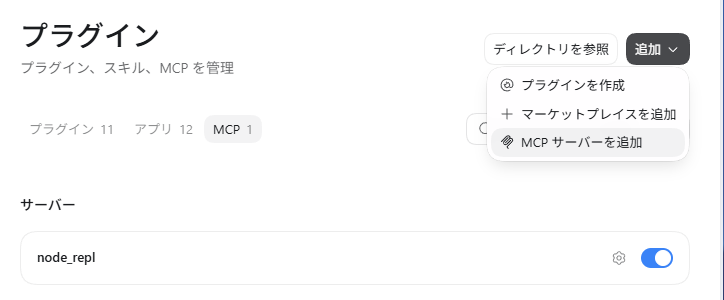
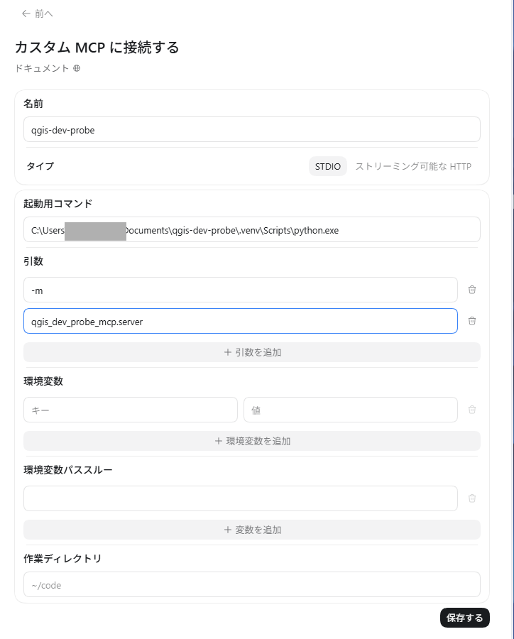
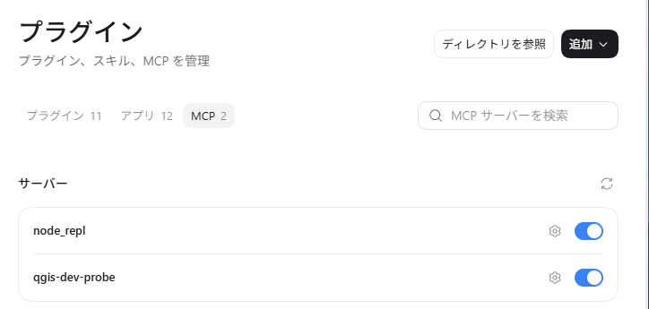
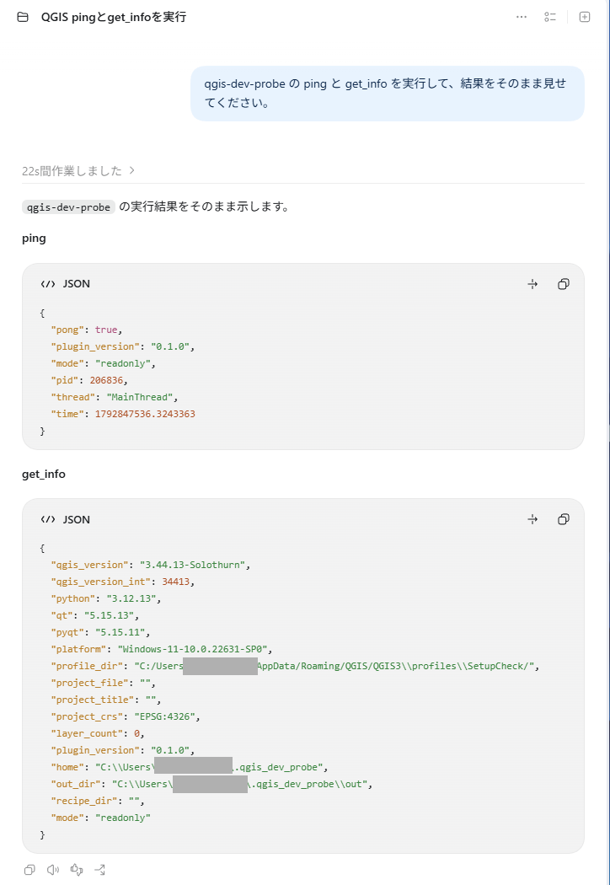

# クライアント設定

共通: MCP サーバーは `python -m qgis_dev_probe_mcp.server`（`pip install -e .` 後は `qgis-dev-probe-mcp` でも可）。
接続先は `endpoint.json` から自動取得するため、**クライアント設定にトークンは不要**。QGIS を同じ OS ユーザーで動かすこと（別ホームなら `QGIS_DEV_PROBE_HOME` を両方に設定）。

> Claude Desktop・Claude Code・Codex（ChatGPT デスクトップアプリ内の Codex）は実機で接続を確認済み。確認した範囲は各節に書いています。Codex の CLI と IDE 拡張は**未確認**です。

## Claude Desktop（`claude_desktop_config.json`）

```json
{
  "mcpServers": {
    "qgis-dev-probe": {
      "command": "C:\\path\\to\\repo\\.venv\\Scripts\\python.exe",
      "args": ["-m", "qgis_dev_probe_mcp.server"]
    }
  }
}
```

## Claude Code

```powershell
claude mcp add qgis-dev-probe -- C:\path\to\repo\.venv\Scripts\python.exe -m qgis_dev_probe_mcp.server
```
（`claude mcp add` は、実行したフォルダ限定（local）で登録される。どのフォルダでも使うなら `-s user`。構文は `claude mcp add --help` で要確認）

確認済み: Claude Code v2.1.310 で `claude mcp list` が Connected、ツール呼び出しも成功。呼び出しが `Login expired` になる場合は Claude Code 側で `/login`（このツールとは無関係）。

## Codex（OpenAI）

Codex は、ChatGPT デスクトップアプリ・Codex CLI・IDE 拡張の 3 つで **同じ設定ファイル（`C:\Users\<ユーザー名>\.codex\config.toml`）を共有**します（公式ドキュメントの記載。画面から登録した内容がこのファイルに書かれると推測していますが、ファイルの中身は未確認です）。どの入口から登録しても構いません。

### A. ChatGPT デスクトップアプリから登録する（実機で確認済み）

確認した環境: Windows 11、ChatGPT デスクトップアプリ（設定の「エージェントの環境」が「Windows ネイティブ」）、QGIS 3.44.13、qgis-dev-probe 0.1.0。画面の名称は 2026-10-24 時点のもので、アプリの更新で変わることがあります。

**事前に必要なもの**

- [SETUP.md](SETUP.md) の手順 2 が終わっていること（`.venv` ができていて、`python.exe` の**絶対パス**が分かる）。
- 絶対パスの確認コマンド（PowerShell 7）:

```powershell
Set-Location $HOME
(Resolve-Path "$HOME\Documents\qgis-dev-probe\.venv\Scripts\python.exe").Path
```

**手順**

1. アプリの「設定」を開き、左のメニュー「連携」の「プラグイン」を選びます。公式ドキュメントにある「MCP servers」という項目は、この画面では見つかりませんでした。「接続」（コーディングの下にある項目）は、スマートフォンなど別の機器からこの PC を操作するための設定で、**MCP とは無関係**です。
2. 上のタブ「MCP」を開き、右上の「追加」を押して、一番下の「MCP サーバーを追加」を選びます。



3. 「カスタム MCP に接続する」の画面に、次のとおり入力して「保存する」を押します。

| 項目 | 入力する値 |
|---|---|
| 名前 | `qgis-dev-probe` |
| タイプ | `STDIO`（そのまま） |
| 起動用コマンド | 手順「事前に必要なもの」で確認した `python.exe` の絶対パス |
| 引数 1 つ目 | `-m` |
| 引数 2 つ目 | `qgis_dev_probe_mcp.server` |
| 環境変数・環境変数パススルー・作業ディレクトリ | 空のまま |

- 引数は、「+ 引数を追加」で欄を増やし、**1 つの欄に 1 つずつ**入れます。`-m qgis_dev_probe_mcp.server` を 1 つの欄にまとめないでください。引数の欄を空のまま保存すると、`python.exe` だけが起動してしまい、接続できません。
- トークンは入れません。接続先は `endpoint.json` から自動で取得されます。



4. 保存すると、「MCP」タブの「サーバー」に `qgis-dev-probe` が加わり、右のスイッチが青（有効）になります。ここまでで**登録は完了**ですが、QGIS とつながるかどうかは、次の疎通確認で確かめます。



**疎通確認**

前提: QGIS が起動していて、QGIS Dev Probe のダイアログの状態が「実行中 / RUNNING」であること（[SETUP.md](SETUP.md) の手順 3）。

Codex の入力欄に次の文を送ります。実行の許可を求められたら許可します（この 2 つは QGIS の状態を読むだけで、何も変更しません）。

```
qgis-dev-probe の ping と get_info を実行して、結果をそのまま見せてください。
```

成功すると、`ping` は `"pong": true` を返し、`get_info` の `profile_dir` に、接続中の QGIS のプロファイル名が出ます。



**確認できた範囲と、できていない範囲**

| 項目 | 状態 |
|---|---|
| 登録（上記の画面操作）と `ping` / `get_info` の呼び出し | 確認済み（2026-10-24）。同じ QGIS（同じ `pid`）に、Claude と Codex が同時に接続できた |
| 初回の実行時間 | 約 22 秒かかった。MCP サーバーの起動待ちか Codex 側の処理かは**不明** |
| `screenshot` の画像が Codex の画面に表示されるか | **未確認** |
| `interactive` モードの操作・`run_algorithm`（長時間処理）のタイムアウト | **未確認** |
| Codex CLI（`codex mcp add`）・IDE 拡張からの接続 | **未確認** |
| 設定ファイル `config.toml` に実際に書かれる内容 | **未確認**（下の「B」は公式ドキュメントから組んだ例） |

**うまくいかないとき**

| 症状 | 確認すること |
|---|---|
| 一覧に `qgis-dev-probe` はあるが呼び出しでエラーになる | QGIS が起動していない、またはダイアログが「停止中」。起動して「サーバー起動」を押す |
| 「起動に失敗した」「タイムアウト」 | 引数が 2 欄に分かれているか、`python.exe` のパスが正しいか。起動が遅い場合は、下の `startup_timeout_sec`（公式の既定は 10 秒）を延ばす |
| `[not_running]` | サーバーが停止中。SETUP.md の手順 3 |

### B. 設定ファイルに直接書く / CLI で登録する（**未確認**）

公式ドキュメントの記載から組んだ例です。設定ファイルを直す前に、バックアップを取ってください。

```powershell
# PowerShell 7（ファイルが無い場合は何も起きません）
Set-Location $HOME
Copy-Item $HOME\.codex\config.toml $HOME\.codex\config.toml.bak -ErrorAction SilentlyContinue
```

```toml
[mcp_servers.qgis-dev-probe]
command = "C:\\Users\\<ユーザー名>\\Documents\\qgis-dev-probe\\.venv\\Scripts\\python.exe"
args = ["-m", "qgis_dev_probe_mcp.server"]
startup_timeout_sec = 30
```

- TOML の文字列の中では、`\` を `\\` と 2 つ重ねます。
- 起動が遅くて失敗するときだけ、`startup_timeout_sec`（既定 10 秒）を足します。
- CLI の場合: `codex mcp add qgis-dev-probe -- <python.exe の絶対パス> -m qgis_dev_probe_mcp.server`（書式はバージョンで違う可能性があるため、先に `codex mcp --help` を見る）。
- 元に戻すには、バックアップを戻します: `Copy-Item $HOME\.codex\config.toml.bak $HOME\.codex\config.toml -Force`

### 安全に関する注意

- Codex の設定画面に、承認なしで PC 上のコマンドを実行できる「フルアクセス」があります。qgis-dev-probe 側のモード（既定は `readonly`）とは**別の設定**です。probe を `readonly` にしておけば、probe 経由で QGIS の状態が変更されることはありませんが、Codex 自身の権限は probe では制限できません。
- 上のスクリーンショットには、検証に使ったユーザー名とパスが写っています。自分の環境の値に読み替えてください。

## 機能差・制約

| 項目 | Claude Desktop / Code / Codex | ChatGPT Web・アプリ |
|---|---|---|
| 利用可否 | stdio でローカル起動できる | **不可**（リモート HTTPS のみ。本ツールは localhost 専用で、公開する設計にしていない） |
| screenshot の画像表示 | クライアントごとに差の可能性あり（**未確認**）。ファイルパスは必ずテキストでも返す | - |
| 長時間 `run_algorithm` | クライアントのツール呼び出しタイムアウトに依存（**未確認**）。`timeout_s` を指定 | - |
